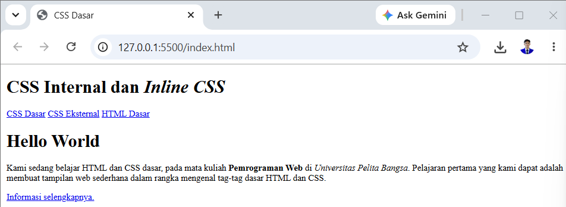
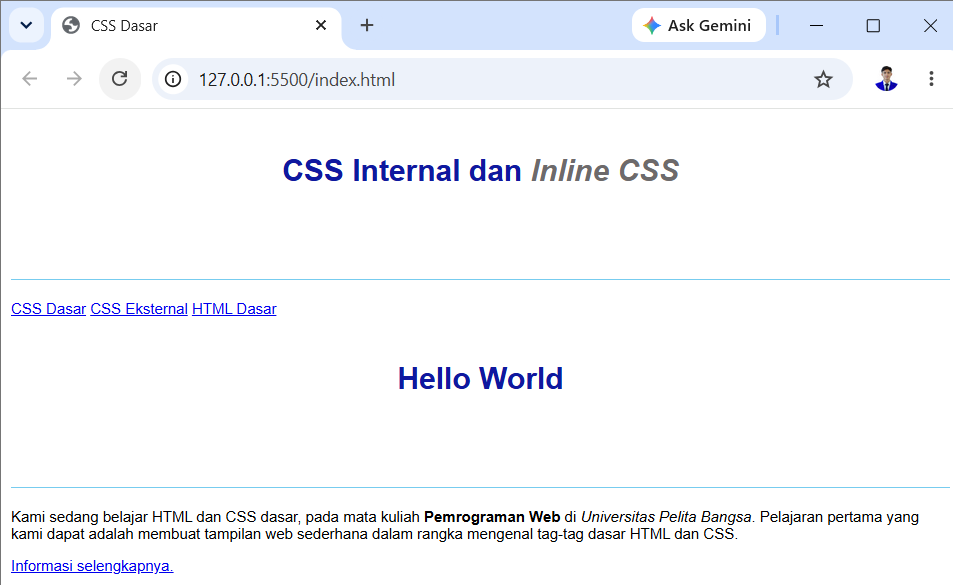
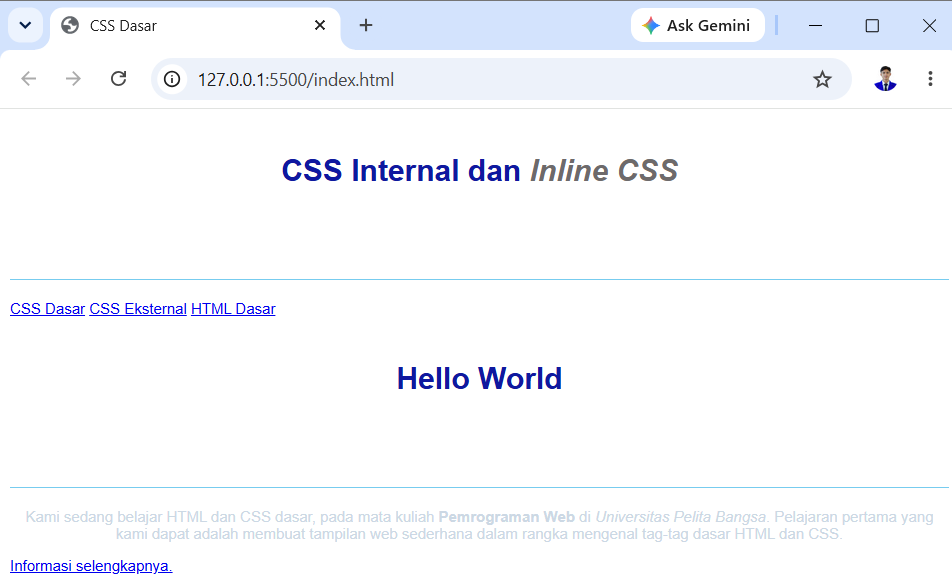
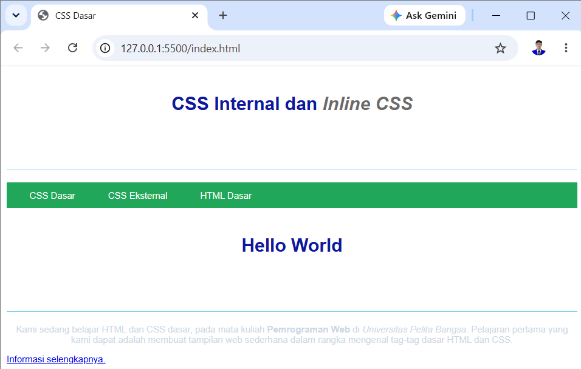
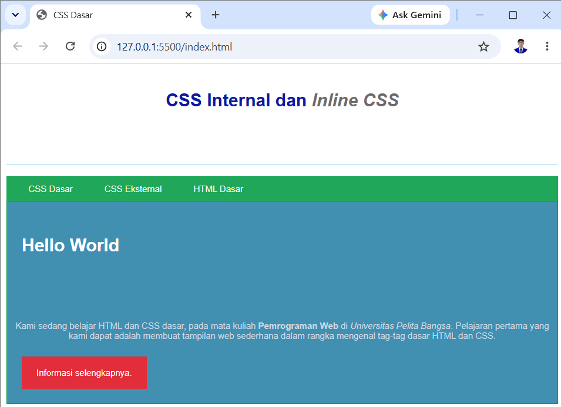

|  |  |
| -------- | --- |
| **Nama** | Tedi Mulyadi |
| **NIM** | 312510163 |
| **Kelas** | I251B |
| **Mata Kuliah** | Pemrograman web |
| **Dosen** | Agung Nugroho, S.Kom., M.Kom. |  

---

### 1. Membuat dokumen HTML

Kode ini berfungsi membangun struktur web. Di dalamnya terdapat bagian judul (<header>), menu penunjuk jalan (<nav>), serta area konten utama (<div id="intro">). Kita juga menambahkan label identitas seperti id="intro" dan class="button btn-primary" agar bagian-bagian tersebut bisa kita beri gaya tampilan di langkah berikutnya.

```html
<!DOCTYPE html>
<html lang="id">
<head>
    <meta charset="UTF-8">
    <meta name="viewport" content="width=device-width, initial-scale=1.0">
    <title>CSS Dasar</title>
</head>
<body>
    <header>
        <h1>CSS Internal dan <i>Inline CSS</i></h1>
    </header>
    <nav>
        <a href="lab2_css_dasar.html">CSS Dasar</a>
        <a href="lab2_css_eksternal.html">CSS Eksternal</a>
        <a href="lab1_tag_dasar.html">HTML Dasar</a>
    </nav>

    <!-- Elemen dengan ID Selector -->
    <div id="intro">
        <h1>Hello World</h1>
        <p>Kami sedang belajar HTML dan CSS dasar, pada mata kuliah <b>Pemrograman Web</b> di <i>Universitas Pelita Bangsa</i>. Pelajaran pertama yang kami dapat adalah membuat tampilan web sederhana dalam rangka mengenal tag-tag dasar HTML dan CSS.</p>
        
        <!-- Elemen dengan Class Selector -->
        <a class="button btn-primary" href="#intro">Informasi selengkapnya.</a>
    </div>
</body>
</html>
```

### Output



---

### 2. Mendeklarasikan CSS Internal

Perintah ini bertugas mengubah jenis font seluruh halaman menjadi 'Open Sans', sekaligus mempercantik judul h1 dengan warna biru, posisi di tengah, serta garis pembatas di bagian bawahnya.

```html
<head>
    <meta charset="UTF-8">
    <meta name="viewport" content="width=device-width, initial-scale=1.0">
    <title>CSS Dasar</title>
    <style>
        body {
            font-family: 'Open Sans', sans-serif;
        }
        header {
            /* Area penataan khusus header */
        }
        h1 {
            min-height: 80px;
            border-bottom: 1px solid #77CCEF;
            font-size: 24px;
            color: #0F189F;
            text-align: center;
            padding: 20px 10px;
        }
        h1 i {
            color: #6d6a6b;
        }
    </style>
</head>
```

### Output



---

### 3. Menambahkan inline CSS

Cara ini digunakan untuk mengubah tampilan hanya pada paragraf tersebut secara spesifik, yaitu membuat teks berada di tengah dan warnanya menjadi biru abu-abu terang.

```html
<p style="text-align: center; color: #ccd8e4;">
    Kami sedang belajar HTML dan CSS dasar, pada mata kuliah <b>Pemrograman Web</b> di <i>Universitas Pelita Bangsa</i>. Pelajaran pertama yang kami dapat adalah membuat tampilan web sederhana dalam rangka mengenal tag-tag dasar HTML dan CSS.
</p>
```

### Output



---

### 4. Membuat CSS Eksternal

Baris <link> ini berperan sebagai pemicu agar file HTML dapat membaca dan menerapkan seluruh aturan desain yang tersimpan di dalam file terpisah style_eksternal.css.

```html
<head>
    <!-- Menghubungkan file CSS eksternal -->
    <link rel="stylesheet" href="style_eksternal.css" type="text/css">
</head>
```

kemudian 

```html
/* Penataan Bar Navigasi */
nav {
    background: #20A759;
    color: #fff;
    padding: 10px;
}

nav a {
    color: #fff;
    text-decoration: none;
    padding: 10px 20px;
}

nav .active, 
nav a:hover {
    background: #0B6B3A;
}
```
### Output



---

### 5. Menambahkan CSS Selector

Penjelasan:nav: Mewarnai bilah navigasi dengan warna hijau serta merapikan link di dalamnya.   #intro: Menggunakan tanda pagar (#) untuk memberikan latar biru dan bingkai pada wadah khusus yang memiliki id="intro".   .button & .btn-primary: Menggunakan tanda titik (.) untuk membentuk tombol interaktif berwarna merah.   

```html
/* Penataan Bar Navigasi */
nav {
    background: #20A759;
    color: #fff;
    padding: 10px;
}

nav a {
    color: #fff;
    text-decoration: none;
    padding: 10px 20px;
}

nav .active, 
nav a:hover {
    background: #0B6B3A;
}

/* ID Selector */
#intro {
    background: #418fb1;
    border: 1px solid #099249;
    min-height: 100px;
    padding: 10px;
}

#intro h1 {
    text-align: left;
    border: 0;
    color: #fff;
}

/* Class Selector */
.button {
    padding: 15px 20px;
    background: #bebcbd;
    color: #fff;
    display: inline-block;
    margin: 10px;
    text-decoration: none;
}

.btn-primary {
    background: #e22d3a;
}
```

### Output



---
